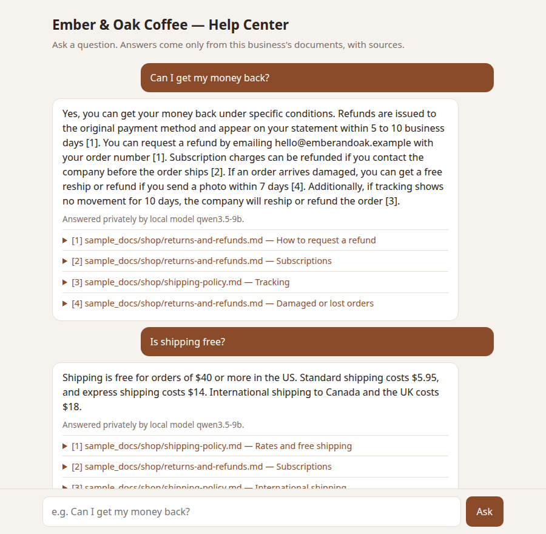

# ragkit — a support chatbot that answers from *your* documents

[](https://github.com/RemyRah/ragkit/actions/workflows/ci.yml)
[](LICENSE)

**Your customers ask "can I get my money back?" — ragkit finds the answer in
your refund policy and shows exactly where it came from.** Drop in your FAQ,
policies and product sheets (Markdown, text, PDF or Word) and get a private
chat page for your site or your support team.



*The demo above runs on a fictional coffee roaster's docs that ship with this
repo. Written answers come from Claude or a free local model; with neither set
up, it still works and shows the matching passages.*

## Why a business would want this

- **Answers only from your documents.** It cites the policy section it used,
  and says so when the answer isn't there instead of making something up.
- **Private by default.** Runs on your own machine or server. Pair it with a
  local model and your documents never leave the building.
- **Cheap to run.** Search is built in and free. Claude answers use a
  low-cost model by default.
- **Easy to update.** Change a policy file and restart — no retraining.

## Quickstart (3 steps)

You need Python 3.10 or newer. Nothing else to install.

1. **Download it**
   ```bash
   git clone https://github.com/RemyRah/ragkit.git
   cd ragkit
   ```
2. **Start the chat page with the sample coffee-shop docs**
   ```bash
   python -m ragkit.web --docs sample_docs/shop --title "Ember & Oak Coffee — Help Center"
   ```
3. **Open http://127.0.0.1:8000** and ask *"Can I get my money back?"* or
   *"Is shipping free?"*

To use your own documents, point `--docs` at a folder of your files.
Press `Ctrl+C` in the terminal to stop it.

### Optional upgrades

| Want | Do this |
|---|---|
| Written answers from Claude | `pip install anthropic` and set `ANTHROPIC_API_KEY` |
| Written answers, fully private | Point `RAGKIT_LLM_URL` at any OpenAI-compatible local server (Ollama, llama.cpp, LM Studio), e.g. `http://127.0.0.1:11434/v1`, and set `RAGKIT_LLM_MODEL` |
| Read PDF files | `pip install pypdf` |
| Read Word (.docx) files | `pip install python-docx` |

Missing an upgrade is never an error: ragkit skips PDF/Word files with a
one-line note telling you what to install, and without a Claude key it shows
the most relevant passages instead of a written answer.

---

## Technical details

### Command line

```bash
python cli.py --docs sample_docs/shop "can I get my money back?"
python cli.py --docs ./my_notes --k 6 --show-context "What did we decide about caching?"
```

### How it works

```
load_docs → chunk_documents → Retriever.search → answer
  (disk)      (structure-aware)   (TF-IDF cosine)    (Claude, optional)
```

- **Load** — walk a path; read Markdown/text with the standard library, PDF via
  `pypdf`, DOCX via `python-docx` (Word headings become section headings).
- **Chunk** — split on headings, pack paragraphs to ~900 chars with overlap so
  facts that straddle a boundary still land whole in a chunk.
- **Retrieve** — TF-IDF + cosine similarity, pure stdlib, with light stemming
  and a small, editable synonym map (`ragkit.retriever.SYNONYMS`) so customer
  wording ("money back") matches policy wording ("refund"). The only method
  callers depend on is `search`, so an embedding retriever drops straight in.
- **Answer** — Claude (or a local OpenAI-compatible model via `RAGKIT_LLM_URL`)
  answers *only* from the retrieved passages and cites them; with neither,
  ragkit returns the ranked passages instead. `RAGKIT_LLM_EXTRA` passes
  server-specific JSON (e.g. to switch off a reasoning model's thinking).

### Web UI

`python -m ragkit.web [--docs PATH] [--port 8000] [--title "Help Center"]`
serves one page on `127.0.0.1` using only `http.server`:

- `GET /` — the chat page (`/?q=...` also answers server-side, no JavaScript needed)
- `POST /api/ask` with `{"question": "..."}` → `{"answer", "note", "sources"}`

All document and user text is HTML-escaped on the server, and the page script
only inserts text via `textContent`. The model defaults to `claude-haiku-4-5`;
override with `RAGKIT_MODEL`. It binds to localhost only — put it behind a
reverse proxy with auth before exposing it publicly.

### Use it as a library

```python
from ragkit import load_docs, chunk_documents, answer_question
from ragkit.retriever import Retriever

chunks = chunk_documents(load_docs("sample_docs/shop"))
hits = Retriever(chunks).search("can I get my money back?", k=4)
print(answer_question("can I get my money back?", hits))
```

### Sample data

- `sample_docs/shop/` — *Ember & Oak Coffee Roasters*, a fictional shop: FAQ,
  returns & refunds, shipping policy, product sheet, and a PDF brewing guide
  (regenerate with `python scripts/make_sample_pdf.py`, stdlib only).
- `sample_docs/*.md` — ragkit's own architecture notes.

### Extending

See [`sample_docs/extending.md`](sample_docs/extending.md) — swap the retriever
for embeddings, change the answer model via `RAGKIT_MODEL`, or tune chunking.

### Tests

```bash
pip install pytest            # optional extras enable the PDF/DOCX tests
python -m pytest -q
```

CI runs the suite on Python 3.10–3.12, with and without the optional extras.

## License

MIT — see [LICENSE](LICENSE).
